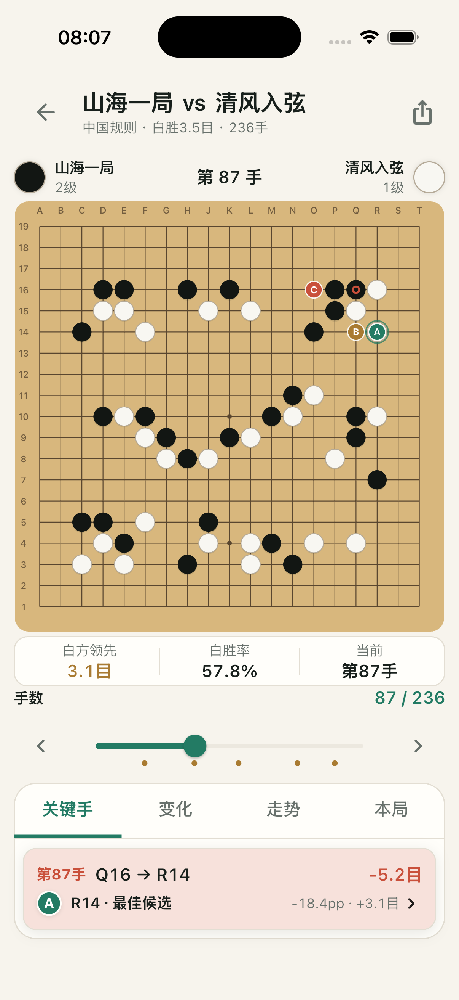
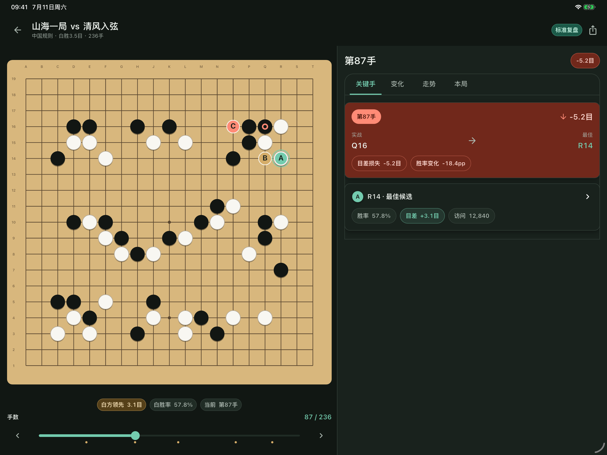
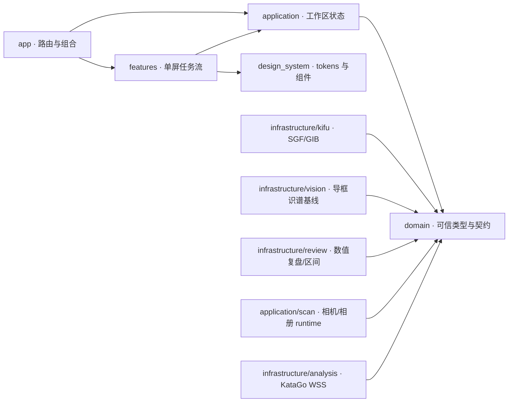

# LizzieYZY Mobile

[](https://github.com/wimi321/lizzieyzy-mobile/actions/workflows/ci.yml)

面向 iOS 与 Android 的开源围棋复盘应用，也是 [LizzieYZY 桌面版](https://github.com/wimi321/lizzieyzy-next)的独立移动端实现。首版只聚焦可信棋谱、拍照识谱、KataGo 数值复盘和单局发挥区间。

> **当前状态：Pre-alpha / 可运行纵向切片。** SGF/GIB、实时相机/相册到导框识别、KataGo WSS provider、数值复盘和棋力区间基础设施已经进入代码与测试；WSS 尚未接入产品配置与真实服务，透视矫正、编号 OCR、生产 HumanSL 权重和正式校准模型仍未完成。界面中的演示分析不能视为真实棋力结论。

<p align="center">
  
  &nbsp;&nbsp;
  
</p>

<p align="center"><sub>Flutter 3.41.6 · iOS 26.4 Simulator 原始实现证据；不是生成图或运行时切图。</sub></p>

## 产品边界

首版只做三件事：

- 从本地 SGF/GIB、实体棋盘或编号棋谱图得到可追溯的棋谱或局面，并在不确定时要求校对或降级。
- 提供候选、主变化、关键手、目差走势和分析参数均可验证的全局复盘。
- 只对完整 19 路非让子棋、且至少有 40 个有效决策的对局计算单局发挥区间。

首版不做在线对弈、社交、自然语言棋评、自动生成实战题、永久棋力档案或录像记谱。

## 当前真实能力

| 子系统 | 状态 | 仓库中已经存在的能力 | 尚未完成 |
| --- | --- | --- | --- |
| Visual Benchmark v1 | ✅ | 3 个北极星方向、10 张批准屏幕、实现截图、prompt、manifest 与 SHA-256 | Figma 仅作为协作镜像，不替代仓库规格 |
| 手机 UI | ✅ 核心流程 | 棋谱/识谱双入口；360×800、375×667、393×852、412×915、430×932 核心页面单屏完成；1.3×、2.0×、3.2×字号模式化适配；平板扩展布局 | 真实数据仍在逐页替换 fixture |
| 设计系统 | ✅ 首版 | 浅/深主题、tokens、棋盘、候选、图表、时间轴、复盘抽屉和单节点棋盘读屏语义 | 全语言与真机无障碍矩阵 |
| 棋谱导入导出 | ✅ 基线 | SGF FF[4] collection 解析、语义导入、未知属性/注释/变化保留、确定性导出；GIB 保守导入；系统文件选择与可信类型降级 | 棋谱树编辑、分享导出、更多来源与旧编码完整覆盖 |
| 图像识谱 | 🟡 基线 | 延迟请求相机权限、生命周期暂停/恢复、后摄预览、闪光灯、三帧快门、相册、真实图片解码、19×19 分类和低置信校对 | 透视/四角检测、9/13 路、复杂光照和编号 OCR 仍待实现 |
| 数值复盘 | ✅ 基线 | `DefaultReviewBuilder` 校验完整分析，生成关键手、阶段、走势和候选命中率 | 真实 KataGo 分析结果接线 |
| 单局棋力 | 🟡 基础设施 | manifest 驱动估计器、模型哈希/HumanSL 约束、80% 区间、低/中置信度；数值管线有 31 个定向测试 | 未分发生产 HumanSL 权重、授权校准集或正式模型卡，不能当长期段位 |
| KataGo | 🟡 Provider 基线 | WSS-only 配置、Bearer header、整局 JSON 请求、并发 request-id 复用、乱序结果归并、视角归一、取消和错误分类测试 | 尚未接入产品 UI、真实服务配置、安全凭据存储、桌面或本机 provider |

详细阶段和退出条件见[路线图](docs/ROADMAP.md)。

## 单屏交互原则

手机核心任务不依赖向下滚动找功能。棋盘、当前决策和最必要指标同屏呈现，更多信息通过 `关键手 / 变化 / 走势 / 本局` 等明确模式切换，而不是不断向页面下方堆卡片。大字号不会被夹小：在 2.0× 与 3.2× 下改用专门的密集模式和标签切换，同时保留完整读屏语义与至少 48dp 触控区。

我们参考[阿Q围棋](http://www.ezandroid.cn/)可观察到的“单屏模式切换”产品原则，但不复制其视觉、文案、资产、协议或代码。该参考只作为公开黑盒行为输入；LizzieYZY Mobile 仍使用自己的信息架构、设计 tokens 与 clean-room 实现。

## 快速开始

固定工具链：Flutter **3.41.6 stable**，随附 Dart 3.11.4。当前仓库实际构建目标为 **iOS 17.0+** 与 **Android 10 / API 29+**；这是已提交的平台配置，不代表已达到商店发布质量。

```bash
flutter pub get
flutter run
```

iOS 构建需要 macOS 与兼容 Xcode；Android 使用 Java 17。相机权限、远端分析安全和生产模型资产仍是发布前闸门。

## 验证

```bash
dart format --output=none --set-exit-if-changed lib test
flutter analyze
python3 .github/scripts/verify_visual_benchmarks.py
python3 .github/scripts/verify_brand_assets.py
flutter test $(find test -type f -name '*_test.dart' ! -name 'golden_test.dart' -print | sort)
flutter test test/golden_test.dart              # 使用批准基线的 macOS 环境
flutter build apk --debug
flutter build ios --simulator --debug --no-codesign
```

CI 固定 Flutter 3.41.6：Linux 执行格式、分析、非 golden 测试、视觉清单校验和 Android debug 构建；macOS 执行 Flutter golden 与 iOS Simulator 构建。完整说明见[测试指南](docs/TESTING.md)。

## 架构概览



- `lib/domain/` 是纯 Dart 可信边界；照片局面、片段和完整棋谱不能互相伪装。
- `lib/infrastructure/kifu/` 实现 SGF/GIB codec，损坏或矛盾记录会报错或降级。
- `lib/infrastructure/vision/` 已有可测试的真实图像基线，但不是最终透视/OCR 模型。
- `lib/infrastructure/analysis/` 实现可测试的 KataGo Analysis JSON over WSS client；产品配置和服务端不在仓库内。
- `lib/infrastructure/review/` 只输出数值与可追溯模型信息，不生成自然语言棋评。
- `lib/features/` 和 `lib/design_system/` 负责单屏触控体验与无障碍语义。

接口、数据流和依赖约束见[架构文档](docs/ARCHITECTURE.md)。

## 视觉母版不是运行时切图

`design/visual-benchmarks/v1/` 中的 PNG 只表达视觉意图和保存实现证据。棋盘、棋子、图表、卡片和控件均由 Flutter、Canvas 或矢量资源实现，禁止把整屏图片或裁剪切片嵌入应用。CI 会同时验证 `manifest.json`、`checksums.sha256`、唯一入选北极星、登记文件集合和实际 SHA-256。

## 开源、许可与 clean-room

本仓库采用 [MPL-2.0](LICENSE)，与 GPLv3 桌面仓库分开维护：

- 不复制、翻译、机械改写或通过 AI 转换桌面 Java 源码及旧 UI 资产。
- 可依据公开标准、公开产品行为和独立测试进行兼容实现，并记录来源。
- 第三方库、模型、训练数据、字体与素材必须具有明确分发许可和可复现版本/哈希。
- 当前直接依赖及许可摘要见[第三方依赖与通知](docs/THIRD_PARTY_NOTICES.md)。

贡献前请阅读 [clean-room 政策](docs/CLEAN_ROOM.md)和[贡献指南](CONTRIBUTING.md)。安全问题请按 [SECURITY.md](SECURITY.md) 私密报告；社区互动遵循 [CODE_OF_CONDUCT.md](CODE_OF_CONDUCT.md)。

## English summary

LizzieYZY Mobile is an MPL-2.0, mobile-first Go review application for iOS 17+ and Android 10/API 29+. The repository contains tested SGF FF[4] import/export, conservative GIB import, file import, live camera/gallery capture feeding a guide-aligned 19×19 recognizer, a KataGo Analysis JSON WSS provider, deterministic numeric review building, and a manifest-driven single-game performance estimator. Core phone tasks use one viewport and explicit mode switching. The WSS provider is not yet wired to product configuration or a production service; perspective/OCR vision, production HumanSL/calibration artifacts, and local/desktop KataGo providers remain unfinished.
