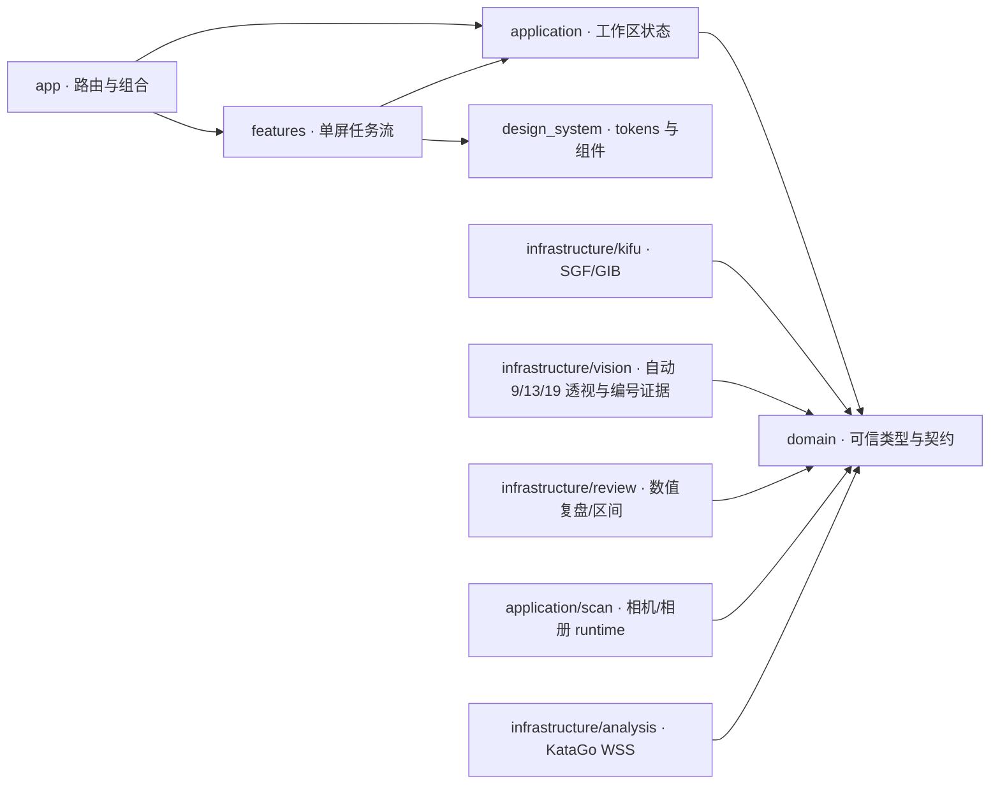

# LizzieYZY Mobile

[](https://github.com/wimi321/lizzieyzy-mobile/actions/workflows/ci.yml)

面向 iOS 与 Android 的开源围棋复盘应用，也是 [LizzieYZY 桌面版](https://github.com/wimi321/lizzieyzy-next)的独立移动端实现。首版只聚焦可信棋谱、拍照识谱、KataGo 数值复盘和单局发挥区间。

> **当前状态：Pre-alpha / 可运行纵向切片。** SGF/GIB 持久化与系统导入、相机/相册、自动 9/13/19 路透视检测、编号候选与规则求解、KataGo WSS 设置/会话、用户部署的桌面 GPU 桥，以及真实数值复盘路由已经进入代码与测试。仓库没有默认分析服务或生产棋力模型，也没有完成真实手机到真实桌面 GPU 的受控互操作、独立真实照片准确率、10,000 局面桌面对照、真机无障碍、SUS 或商店审核；合成测试和演示结果不能视为正式棋力或发布质量证明。

<p align="center">
  
  &nbsp;&nbsp;
  
</p>

<p align="center"><sub>Flutter 3.41.6 UI 实现截图；采集环境与提交见 Visual Benchmark manifest，不是生成图或运行时切图，也不证明当前含 ML Kit 的 iOS 26.4 Simulator 构建可用。</sub></p>

## 产品边界

首版只做三件事：

- 从本地 SGF/GIB、实体棋盘或编号棋谱图得到可追溯的棋谱或局面，并在不确定时要求校对或降级。
- 提供候选、主变化、关键手、目差走势和分析参数均可验证的全局复盘。
- 单局发挥区间仅在完整 19 路非让子棋、至少有 40 个有效决策，且本版本存在通过留出集验证的生产校准 artifact 时显示；当前 0.1.0 不分发该 artifact。

首版不做在线对弈、社交、自然语言棋评、自动生成实战题、永久棋力档案或录像记谱。

## 当前真实能力

| 子系统 | 状态 | 仓库中已经存在的能力 | 尚未完成 |
| --- | --- | --- | --- |
| Visual Benchmark v1 | ✅ | 3 个北极星方向、10 张批准屏幕、实现截图、prompt、manifest 与 SHA-256 | Figma 仅作为协作镜像，不替代仓库规格 |
| 手机 UI | ✅ 核心流程 | 棋谱/识谱双入口；持久化文档 → 分析 → 关键手/变化/走势/本局 → 分享由真实领域对象驱动；360×800、375×667、393×852、412×915、430×932 单屏回归；1.3×、2.0×、3.2×字号与平板扩展布局 | 真机无障碍、可用性和长尾数据长度验证；fixture 只保留在测试/设计证据中 |
| 设计系统 | ✅ 首版 | 浅/深主题、tokens、棋盘、候选、图表、时间轴、复盘抽屉和单节点棋盘读屏语义 | 全语言与真机无障碍矩阵 |
| 棋谱导入导出 | ✅ 基线 | SGF FF[4] collection、GIB 保守导入与 UTF-8/CP949/GB18030/GBK/Big5 严格往返判定、可信降级；16 MiB/树深/节点/属性限额；应用私有持久化、系统打开/分享导入和 SGF 系统分享 | 棋谱树编辑、更多来源和跨版本迁移实测 |
| 图像识谱 | 🟡 工程基线 | 延迟相机权限、生命周期、三帧快门/相册、有界图片预算；自动格线/四角、9/13/19 路判型、单应透视、逐点分类；ML Kit 数字候选、低置信校对和 `RuleCheckedSequenceSolver` | 复杂光照、反光/遮挡、真实编号图、授权独立数据集指标和多设备真机验证 |
| 数值复盘 | ✅ 代码闭环 | WSS 分析完成后由 `DefaultReviewBuilder` 生成真实关键手、阶段、走势和候选命中率，并贯通变化、本局与分享；静态局面和片段不会伪装完整复盘 | 受控真实 KataGo 服务互操作、10,000 局面桌面对照和可用性任务验证 |
| 单局棋力 | 🟡 基础设施 | manifest 驱动估计器、模型哈希/HumanSL 约束、80% 区间、低/中置信度；数值管线有 34 个定向测试 | 未分发生产 HumanSL 权重、授权校准集或正式模型卡，当前产品拒绝显示级段区间 |
| KataGo | 🟡 WSS + 桌面桥代码闭环 | 服务清单导入、WSS-only、Keychain/Keystore token、逐次发送确认、整局请求、应用作用域分析会话、取消/重试、结果归并与资源预算；`tool/katago_bridge/` 提供 TLS/Bearer、严格协议、manifest/artifact 绑定和私有 staging 的 WSS → KataGo JSONL 桌面桥 | 仓库无默认服务、引擎或模型；真实手机 ↔ 用户桌面 GPU 的证书/认证部署与互操作、10,000 局面对照、原生本机 provider 尚未完成 |

详细阶段和退出条件见[路线图](docs/ROADMAP.md)。

## 单屏交互原则

手机核心任务不依赖向下滚动找功能。棋盘、当前决策和最必要指标同屏呈现，更多信息通过 `关键手 / 变化 / 走势 / 本局` 等明确模式切换，而不是不断向页面下方堆卡片。大字号不会被夹小：在 2.0× 与 3.2× 下改用专门的密集模式和标签切换，同时保留完整读屏语义与至少 48dp 触控区。

我们参考[阿Q围棋](http://www.ezandroid.cn/)可观察到的“单屏模式切换”产品原则，但不复制其视觉、文案、资产、协议或代码。该参考只作为公开黑盒行为输入；LizzieYZY Mobile 仍使用自己的信息架构、设计 tokens 与 clean-room 实现。

## 快速开始

固定工具链：Flutter **3.41.6 stable**，随附 Dart 3.11.4。当前仓库实际构建目标为 **iOS 17.0+** 与 **Android 10 / API 29+**；这是已提交的平台配置，不代表已达到商店发布质量。

```bash
flutter pub get
flutter run
```

iOS 构建需要 macOS 与兼容 Xcode；Android 使用 Java 17。相机/照片保留真机审计、远端服务互操作、生产模型资产和商店隐私核对仍是发布前闸门。

已验证的外部限制：当前 GoogleMLKit 9.x / MLKitVision 10.x CocoaPods 缺少 Apple Silicon iOS 26+ Simulator 所需的 `arm64-iphonesimulator` slice；iOS device `--no-codesign` release 构建已通过，但该模拟器组合仍受上游二进制阻塞。仓库不默认启用修改第三方 Mach-O 平台标记的补丁。

## 验证

```bash
dart format --output=none --set-exit-if-changed lib test
flutter analyze --fatal-infos
python3 .github/scripts/verify_visual_benchmarks.py
python3 .github/scripts/verify_golden_font.py
python3 .github/scripts/verify_brand_assets.py
python3 .github/scripts/verify_privacy_declarations.py
python3 .github/scripts/verify_action_pins.py
python3 .github/scripts/verify_gradle_integrity.py
python3 .github/scripts/verify_release_workflows.py
python3 .github/scripts/verify_native_inbound_contract.py
python3 .github/scripts/verify_no_ui_fixture_imports.py
python3 .github/scripts/verify_design_token_usage.py
python3 tool/verify_licenses.py
python3.12 -m venv build/bridge-venv
build/bridge-venv/bin/python -m pip install --disable-pip-version-check \
  --require-hashes -r tool/katago_bridge/requirements.lock
build/bridge-venv/bin/python -m py_compile \
  tool/katago_bridge/*.py tool/katago_bridge/tests/*.py
PYTHONPATH=tool build/bridge-venv/bin/python -m unittest discover \
  -s tool/katago_bridge/tests -v
python3 -m unittest discover -s tool/tests -v
flutter test $(find test -type f -name '*_test.dart' ! -name 'golden_test.dart' -print | sort)
flutter test test/golden_test.dart              # 使用批准基线的 macOS 环境
flutter build apk --release \
  --split-debug-info=build/symbols/android
flutter build ios --release --no-codesign \
  --split-debug-info=build/symbols/ios           # iOS device，不产生签名包
```

CI 工作流固定 Flutter 3.41.6，并在 Ubuntu 24.04 / Python 3.12 用 `--require-hashes` 安装桌面桥依赖、编译全部 Python 文件并运行桥接测试；同时配置格式、分析、Flutter 测试、视觉/品牌/隐私/fixture/许可 guards、Android release 最终包门禁与 iOS 构建。tag release-readiness 要求 tag 精确等于 `v<pubspec version>`（包含 `+build`），复跑 macOS golden，保留 Android R8/native/Flutter symbols 与 UUID 匹配的全部 iOS dSYM，并生成四生态 CycloneDX SBOM、完整许可、checksums 和带自定义完整性签名的确定性证据包。该自定义声明明确不是 SLSA build provenance。工作流配置不等于对应 GitHub Actions job 已通过；即使 CI 全绿，也不等于真实手机 ↔ 桌面 GPU、真机、签名或商店审核通过。完整说明见[测试指南](docs/TESTING.md)与[发布证据规范](docs/RELEASE_EVIDENCE.md)。

发布隐私事实见[隐私政策](PRIVACY.md)与 [Android Data Safety 工作底稿](docs/ANDROID_DATA_SAFETY.md)。生成完整候选 SBOM：

```bash
mkdir -p build/sbom
./android/gradlew -p android :app:dependencies \
  --configuration releaseRuntimeClasspath \
  --dependency-verification=strict --console=plain \
  > build/sbom/android-release-runtime.txt
python3 tool/native_licenses.py maven \
  --android-report build/sbom/android-release-runtime.txt \
  --manifest-output build/sbom/maven-artifacts.json --check
python3 tool/sbom.py generate \
  --output build/sbom/lizzieyzy-mobile.cdx.json \
  --android-report build/sbom/android-release-runtime.txt \
  --maven-manifest build/sbom/maven-artifacts.json
python3 tool/sbom.py validate \
  --input build/sbom/lizzieyzy-mobile.cdx.json \
  --require-ecosystem pub --require-ecosystem cocoapods \
  --require-ecosystem python --require-ecosystem maven
```

## 架构概览



- `lib/domain/` 是纯 Dart 可信边界；照片局面、片段和完整棋谱不能互相伪装。
- `lib/infrastructure/kifu/` 实现 SGF/GIB codec，损坏或矛盾记录会报错或降级。
- `lib/infrastructure/vision/` 已有有界自动 9/13/19 路透视、分类、编号候选和严格规则求解，但合成测试不等于发布准确率声明。
- `lib/infrastructure/analysis/` 与应用层实现 KataGo Analysis JSON over WSS 设置/会话；`tool/katago_bridge/` 是仓库内可审计的桌面服务参考实现，但不会打进手机包，也不是默认托管服务。
- `lib/infrastructure/review/` 只输出数值与可追溯模型信息，不生成自然语言棋评。
- `lib/features/` 和 `lib/design_system/` 负责单屏触控体验与无障碍语义。

接口、数据流和依赖约束见[架构文档](docs/ARCHITECTURE.md)。

## 视觉母版不是运行时切图

`design/visual-benchmarks/v1/` 中的 PNG 只表达视觉意图和保存实现证据。棋盘、棋子、图表、卡片和控件均由 Flutter、Canvas 或矢量资源实现，禁止把整屏图片或裁剪切片嵌入应用。CI 会同时验证 `manifest.json`、`checksums.sha256`、唯一入选北极星、登记文件集合和实际 SHA-256。

## 开源、许可与 clean-room

本仓库采用 [MPL-2.0](LICENSE)，与 GPLv3 桌面仓库分开维护：

- 不复制、翻译、机械改写或通过 AI 转换桌面 Java 源码及旧 UI 资产。
- 可依据公开标准、公开产品行为和独立测试进行兼容实现，并记录来源。
- 第三方库、模型、训练数据、字体与素材必须具有明确分发许可和可复现版本/哈希。
- 当前直接依赖、Google ML Kit 原生边界及许可摘要见[第三方依赖与通知](docs/THIRD_PARTY_NOTICES.md)。

贡献前请阅读 [clean-room 政策](docs/CLEAN_ROOM.md)和[贡献指南](CONTRIBUTING.md)。安全问题请按 [SECURITY.md](SECURITY.md) 私密报告；社区互动遵循 [CODE_OF_CONDUCT.md](CODE_OF_CONDUCT.md)。

## English summary

LizzieYZY Mobile is an MPL-2.0, mobile-first Go review application for iOS 17+ and Android 10/API 29+. The runtime contains bounded SGF/GIB import, private on-device persistence and system file ingress, camera/gallery capture, automatic bounded 9/13/19 perspective detection, on-device numbered-diagram evidence with strict rule solving, user-configured WSS analysis with secure token storage, and numeric review routes through sharing. The repository also contains a TLS-only, manifest-bound WSS-to-KataGo JSONL bridge for user-deployed desktop GPUs; it is not bundled into the mobile binaries or offered as a default service. Real phone-to-desktop interoperability, licensed independent recognition benchmarks, 10,000-position desktop parity, physical-device performance/accessibility/usability evidence, signed store builds, production HumanSL calibration, and an on-device KataGo provider remain unfinished.
