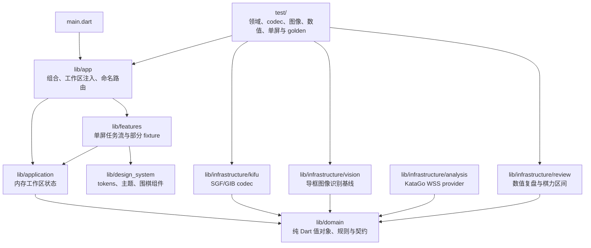
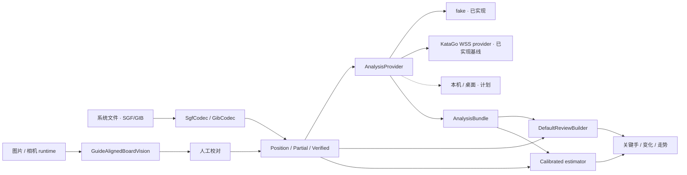

# 架构说明

本文描述当前仓库中的真实边界。接口存在不等于运行时 provider 已完成；演示 fixture 也不等于真实分析结果。

## 设计目标

1. **可信数据优先**：照片局面、片段棋谱和完整棋谱在类型层分离，不确定输入只能校对或降级。
2. **纯数值复盘**：候选、目损、胜率、PV、阶段指标和棋力区间必须可追溯，不生成自然语言棋评。
3. **分析可替换**：本机 KataGo、配对桌面和 WSS 服务最终通过同一 `AnalysisProvider` 接口接入。
4. **手机单屏优先**：核心任务在一个手机视口内通过明确模式切换完成；平板扩展信息，不缩小桌面 UI。
5. **离线与最小权限**：领域、codec 和数值复盘不依赖网络；文件、照片、相机和远端分析分别授权。
6. **clean-room**：移动端不复制 GPL 桌面源码、视觉资产或第三方实现。

## 当前分层

依赖方向必须保持为外层实现依赖领域接口；`lib/domain/` 不得反向依赖 Flutter、文件选择器、图片库、相机、WebSocket 或引擎。

### `lib/domain/`

核心可信边界是 `sealed KifuDocument`：

- `PositionSnapshot`：只确认当前棋盘；未确认时不推断轮到谁。
- `PartialGameRecord`：连续但不完整或存在警告的片段，保留初始局面与起始手数。
- `VerifiedGameRecord`：构造时通过规则校验的完整手顺；只有该类型能进入棋力评估。

规则校验覆盖轮次、越界、占点、提子、自杀、简单劫、位置超级劫和局面超级劫。赛事计分、终局死活和全部厂商格式方言仍不在该规则核心中。

### `lib/application/`、`lib/features/` 与 `lib/app/`

- `KifuWorkspaceController` 保存当前进程内导入的可信文档；持久化与迁移尚未实现。
- 本地文件选择器将 SGF/GIB 交给 codec，并把警告和可信类型明确展示给用户。
- 复盘、变化和棋力页面仍有 fixture 数据，不能据此认定 KataGo 或生产校准模型已经接入。
- 手机核心页面使用 `Column`、`Expanded`、分段模式和受约束棋盘，不以纵向 `ListView` 承载主任务。测试覆盖 360×800、375×667、393×852、412×915、430×932，以及 1.3×、2.0×、3.2×字号；大字号通过模式化信息密度适配，不夹小字体。
- 平板使用扩展布局；手机和平板共用领域语义，不共用“桌面缩小版”排版。

### `lib/infrastructure/kifu/`

`SgfSyntaxParser` 解析 SGF FF[4] collection、节点、属性、转义与变化树；`SgfCodec` 负责围棋语义、可信类型降级和确定性导出。未知属性、注释、setup stones 与变化保留在 `SgfGameTree` 中。损坏格式抛出带偏移的错误；违反规则、起始手数不完整或中盘 setup 会警告并降级。

`GibCodec` 是对常见行式 GIB 的保守 clean-room 导入器。GIB 没有稳定公开规范，因此矛盾、缺手或非法记录不得猜成完整棋谱。旧编码的文本解码仍是调用者责任。

### `lib/infrastructure/vision/`

`GuideAlignedBoardVision` 已经处理真实编码图片，而不是返回 fixture：

- 解码图片、烘焙 EXIF 方向并应用显式旋转。
- 按居中方形导框取样，支持 3–7 帧概率融合。
- 对 19×19 每个交叉点计算黑/白/空概率，并把低置信点送入校对。
- 在 isolate 中执行 CPU 图像计算，显式拒绝损坏或过小输入。

`lib/application/scan/` 已把 camera、image picker 和 `BoardVision` 组合成运行时状态机：权限首次进入相机页时才请求；支持后摄预览、闪光模式、三帧快门、单帧降级、相册、生命周期暂停/恢复、临时拍照文件清理和显式失败状态。平台插件通过 `ScanCapturePlatform` 隔离，widget 测试可注入 fake。

这仍是**无透视导框基线**，不是最终拍照识谱模型。它尚未包含自动四角检测、透视矫正、9/13 路、自适应复杂光照或编号棋谱 OCR。

### `lib/infrastructure/analysis/`

`WssKataGoAnalysisProvider` 实现 KataGo Analysis Engine JSON 的 WSS 客户端基线：

- 配置只接受 `wss://`，显式声明 `reportAnalysisWinratesAs` 和模型 manifest。
- 发送整局、所有分析手数、visits、PV、ownership/policy 配置，并可附 Bearer header。
- 一个 socket 复用多个 request id；乱序最终结果按手数归并，搜索中结果不会污染完成数据。
- BLACK、WHITE、SIDETOMOVE 输出统一转换为领域层黑方胜率/目差。
- 实战手必须出现在对应分析结果中，之后才计算目损与胜率损失。
- 支持取消/terminate、关闭、连接超时、提前断线和按请求路由协议错误。

Provider 已有 fake WebSocket 协议测试，但尚未接入产品设置、生产服务、Keychain/Keystore 凭据或复盘页面。它也不等于本机/桌面 KataGo provider。

### `lib/infrastructure/review/`

`ReviewInputValidator` 将完整棋谱与每个分析节点逐一配对，校验文档 ID、棋盘、手顺、轮次、候选、访问数和损失完整度。

`DefaultReviewBuilder` 只生成确定性数值报告：关键手按目损与手数稳定排序；输出目差走势、开局/中盘/官子指标、严重失误率与 Top-1/3/5 候选命中率。

`CalibratedGamePerformanceEstimator` 只接受完整 19 路非让子棋，排除 Pass 后至少需要 40 个有效决策。它验证分析档位、逐节点 visits、分析模型 SHA-256、HumanSL 档位元数据和版本化校准 manifest，输出固定 80% 区间及低/中置信度。仓库当前只有用于证明算法和约束的测试校准；没有可发布的 HumanSL 权重、授权训练集或生产模型卡。

公共接口与当前实现：

| 接口 | 输入/输出 | 当前实现 |
| --- | --- | --- |
| `BoardVision` | `FrameBundle → ScanDraft` | `GuideAlignedBoardVision` 保守 19 路导框基线 |
| `SequenceSolver` | OCR token + 规则 → `KifuDocument` | 仅契约；编号 OCR/冲突求解待实现 |
| `AnalysisProvider` | 请求、流式事件、取消 → `AnalysisBundle` | 确定性 fake + `WssKataGoAnalysisProvider`；本机/桌面待实现 |
| `ReviewBuilder` | 棋谱 + 分析 → `ReviewReport` | `DefaultReviewBuilder` |
| `GamePerformanceEstimator` | 完整棋谱 + 分析 + 模型 → 区间 | `CalibratedGamePerformanceEstimator`；生产 artifact 未分发 |

## 当前与目标数据流

### 降级规则

1. 普通单张照片默认只能产生 `PositionSnapshot`。
2. 编号连续且经过规则唯一验证时，编号图才可产生完整棋谱。
3. SGF/GIB 中的缺手、未知规则、中盘 setup 或矛盾轮次必须报错或降级。
4. 静态局面可以显示候选和形势，但不能显示关键手时间轴或棋力区间。
5. 少于 40 个非 Pass 有效决策、让子棋和非 19 路棋不得显示级段区间。

### 分析一致性

- Provider 必须记录模型 SHA-256、引擎/模型版本、分析档位和 visits。
- 每个请求有稳定 `requestId`；流式事件可取消，失败需区分是否可重试。
- 实战手不在候选列表时，必须单独分析实战分支；不得把“未进入 Top-N”直接当目损。
- WSS provider 已限制 scheme、支持 Bearer header、超时和取消；产品接入前仍必须完成安全令牌存储、证书策略、消息上限和服务端认证威胁建模。

## English summary

The repository now has real SGF/GIB codecs, file import, live camera/gallery capture feeding a conservative 19×19 guide-aligned recognizer, a tested KataGo Analysis JSON WSS provider, deterministic numeric review building, and a manifest-driven performance estimator. Domain documents remain the trust boundary and core phone tasks use one viewport. Product WSS configuration/service wiring, perspective and numbered OCR, production HumanSL calibration, persistence, and local/desktop KataGo providers remain incomplete.
