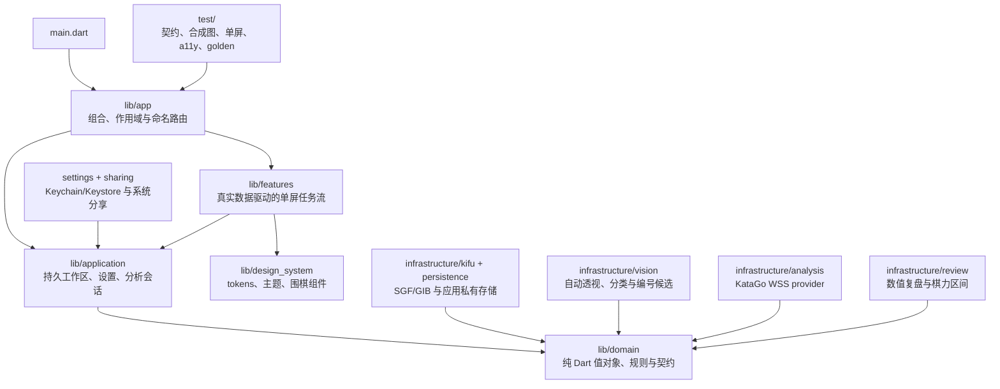
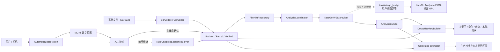

# 架构说明

本文描述当前工作树中已经接通的运行时边界。测试使用的 fixture、内存 WebSocket 和合成棋盘只用于确定性验证，不会进入产品页面或发布包，也不能替代真实服务、真实照片数据集和真机证据。

## 设计目标

1. **可信数据优先**：照片局面、片段棋谱和完整棋谱在类型层分离，不确定输入只能校对或降级。
2. **纯数值复盘**：候选、目损、胜率、PV、阶段指标和棋力区间必须可追溯，不生成自然语言棋评。
3. **分析可替换**：当前产品接入用户配置的 WSS KataGo 服务，仓库提供用户部署的桌面桥；未来原生本机实现仍需复用同一 `AnalysisProvider` 契约。
4. **手机单屏优先**：核心任务在一个手机视口内通过明确模式切换完成；平板扩展信息，不缩小桌面 UI。
5. **离线与最小权限**：领域、codec、持久化和报告构建不依赖网络；文件、照片、相机和远端分析分别授权。
6. **clean-room**：移动端不复制 GPL 桌面源码、视觉资产或第三方实现。

## 当前分层

依赖方向保持为外层实现依赖领域接口；`lib/domain/` 不反向依赖 Flutter、文件选择器、图片库、相机、WebSocket 或引擎。

### `lib/domain/`

核心可信边界是 `sealed KifuDocument`：

- `PositionSnapshot`：只确认当前棋盘；未确认时不推断轮到谁。
- `PartialGameRecord`：连续但不完整或存在警告的片段，保留初始局面与起始手数。
- `VerifiedGameRecord`：构造时通过规则校验的完整手顺；只有该类型能生成完整复盘并进入棋力评估。

规则校验覆盖轮次、越界、占点、提子、自杀、简单劫、位置超级劫和局面超级劫。赛事计分、终局死活和全部厂商格式方言不在该规则核心中。

### `lib/application/`、`lib/features/` 与 `lib/app/`

- `main.dart` 在启动时加载 `PlatformAppSettingsRepository` 和 `FileKifuRepository`，随后接入 Android/iOS 系统打开与分享事件。
- `KifuWorkspaceController` 管理已加载、选中、增加、同可信类型更新、删除和失败状态；产品写操作等待持久化结果。内容去重后，页面持有的是实际入库对象。
- 系统打开/分享入口不会阻塞首帧。Android ContentProvider 与 iOS security-scoped 文件在原生层使用 16 MiB、10 秒、有限并发/排队和主动关闭预算；读取失败只通过不含 URI/路径的 `unreadable` 事件进入现有失败通知。iOS 同时覆盖 `takeInitialKifu` 先于或晚于 UIScene URL 到达的两种顺序：后到的 initial 会转入有界 runtime 队列。原生与 Dart 都不按内容抑制显式重复打开，最终由持久仓库内容寻址到已有棋谱。
- `AnalysisCoordinator` 在应用作用域持有分析会话，支持真实取消、失败重试和离开分析页面后继续；它不是操作系统后台服务。缓存兼容性同时检查文档内容、规则、行棋方、分析档位与服务模型，避免同 ID 复用旧结果。
- 完整分析完成后，`ReviewScreenData` 将同一份 `VerifiedGameRecord`、`AnalysisBundle` 与 `ReviewReport` 传给关键手、变化、走势和本局页面；这些运行时页面不读取设计 fixture。
- `PositionSnapshot` 只能进入单局面候选页；`PartialGameRecord` 只能进入片段确认/导出/保存局面流程，二者都不能伪装完整复盘或棋力区间。
- 手机核心页面不以纵向滚动承载主任务。回归覆盖 360×800、375×667、393×852、412×915、430×932，以及 1.3×、2.0×、3.2×字号；平板使用扩展布局。

### `lib/infrastructure/kifu/` 与 `lib/infrastructure/persistence/`

`SgfSyntaxParser` 解析 SGF FF[4] collection、节点、属性、转义与变化树；`SgfCodec` 负责围棋语义、可信类型降级和确定性导出。未知属性、注释、setup stones 与变化保留在 `SgfGameTree` 中。损坏格式抛出带偏移错误；违反规则、起始手数不完整或中盘 setup 会警告并降级。

`GibCodec` 是对常见行式 GIB 的保守 clean-room 导入器。GIB 没有稳定公开规范，因此矛盾、缺手或非法记录不得猜成完整棋谱。文本层以纯 Dart 有界读取确定性支持 UTF-8、CP949、GB18030/GBK 和 Big5；候选必须严格解码、逐字节往返并通过真实 GIB 结构/规则校验，近似同分时 fail closed。SGF 始终只接受严格 UTF-8。

`FileKifuRepository` 使用 SGF 内容 SHA-256、双槽递增代际索引和原子写入保存应用私有棋谱；启动时验证哈希、UTF-8、资源上限和可信类型，将损坏、孤立或中断写入隔离，而不是静默加载。当前 schema 已有重启、更新、删除、去重和损坏恢复测试；跨版本迁移实测仍是发布门禁。

### `lib/infrastructure/vision/`

产品默认 `ScanCaptureController → HybridBoardVision`，而不是固定返回导框或 fixture：

- `AutomaticBoardVision` 解码真实图片、烘焙 EXIF/显式旋转，在有界 Hough 累加器中寻找两组格线和凸四边形。
- 候选通过 9/13/19 路格点证据判型，单应变换拉正后逐点分类；多帧各自检测、拉正，再按几何与采样质量融合。
- 自动几何、棋盘尺寸或多帧投票不明确时抛出类型化失败，不把居中导框静默冒充自动识别。
- `MlKitDigitTextRecognitionGateway` 在设备上产生数字区域；`HybridBoardVision` 只把落在有效交叉点和棋子上的足量数字提升为编号图。重复、错位、空点和低置信证据进入人工确认或保留实体盘结果。
- `RuleCheckedSequenceSolver` 检查 1…N 连续编号、奇偶颜色、置信度、提子、同点复用、劫和完整规则重放；只有通过后才产生 `VerifiedGameRecord`。
- `GuideAlignedBoardVision` 保留为可注入的 19 路导框实现与测试基线，不是默认自动管线；当前产品 UI 未提供自动失败后切换到该实现的入口。

合成测试已经覆盖透视 9、13、19 路、显式旋转、移动三帧融合、尺寸冲突、空图和几何歧义。这证明算法路径与失败边界可执行，不证明真实拍照准确率；复杂光照、反光、设备差异、遮挡和真实编号图仍需授权独立数据集与多设备真机验证。

### `lib/infrastructure/analysis/`

`WssKataGoAnalysisProvider` 实现 KataGo Analysis Engine JSON 的 WSS 客户端，并通过 `WssAnalysisProviderFactory`、设置页和应用级 `AnalysisCoordinator` 接到产品复盘流程：

- 服务清单固定 `wss://` 端点、模型 manifest 和胜率视角；可选 Bearer token 只持久化到 Keychain/Keystore。
- 用户可以要求每次发送前确认；照片原图不随局面分析发送。
- Provider 发送整局与所有分析手数，一个 socket 可复用多个 request id；乱序最终结果按手数归并。
- BLACK、WHITE、SIDETOMOVE 输出统一转换为领域层黑方胜率/目差；实战手证据经过校验后才计算损失。
- 支持真实取消、关闭、连接/分析超时、提前断线、失败分类与重试。
- 输入、request id、并发数、生命周期请求数、单消息字节、JSONL 行数/深度/结构量、候选数、响应条数和每请求缓冲字节均有上限。

`tool/katago_bridge/` 提供用户自行部署的桌面端参考服务：它只接受 TLS WSS 和 Bearer token，将通过 App 严格 schema 与计算预算验证的消息转发给独立 KataGo Analysis JSONL 子进程。启动时必须同时验证 service/audit manifest、胜率视角，以及 engine/config/normal model/HumanSL model 的 SHA-256 与大小；验证通过的同一文件描述符内容会复制到私有内容寻址 staging，KataGo 不直接读取随后可被替换的原路径。桥不会进入 iOS/Android 安装包，也不提供引擎、模型、证书、token、公网暴露或默认托管服务。

App WSS 单元测试使用进程内 WebSocket 双端；桌面桥的 27 项 Python 测试包含临时 TLS WSS、fake KataGo、鉴权、协议、资源预算、artifact 替换拒绝、模型解析后缀和进程清理，但不访问真实 GPU。真实手机 ↔ 用户桌面 GPU 的证书/认证部署互操作、10,000 固定局面桌面对照及原生本机 provider 仍是外部门禁，不能把自动化协议测试写成桌面一致性结论。

### `lib/infrastructure/review/`

`ReviewInputValidator` 将完整棋谱与每个分析节点逐一配对，校验文档 ID、棋盘、手顺、轮次、候选、访问数、PV 合法性和损失完整度。

`DefaultReviewBuilder` 只生成确定性数值报告：关键手按目损与手数稳定排序；输出目差走势、开局/中盘/官子指标、严重失误率与 Top-1/3/5 候选命中率。运行时已经把这些报告接入关键手、变化、走势、本局和 SGF 分享闭环。

`CalibratedGamePerformanceEstimator` 只接受完整 19 路非让子棋，排除 Pass 后至少需要 40 个有效决策。它验证分析档位、逐节点 visits、分析模型 SHA-256、HumanSL 档位元数据和版本化校准 manifest，输出固定 80% 区间及低/中置信度。仓库只有用于验证算法约束的测试校准；没有可分发的 HumanSL 权重、授权训练/留出集或生产模型卡，因此产品页会明确拒绝展示伪造级段。

公共接口与当前实现：

| 接口 | 输入/输出 | 当前实现 |
| --- | --- | --- |
| `BoardVision` | `FrameBundle → ScanDraft` | 默认 `HybridBoardVision`：自动 9/13/19 透视、分类与按证据提升编号图；`GuideAlignedBoardVision` 仅是可注入实现与测试基线，当前 UI 未暴露切换入口 |
| `SequenceSolver` | OCR token + 规则 → `KifuDocument` | `RuleCheckedSequenceSolver`：严格连续性、颜色、置信度和规则验证 |
| `AnalysisProvider` | 请求、流式事件、取消 → `AnalysisBundle` | 产品接入 `WssKataGoAnalysisProvider`；仓库含用户部署的 WSS 桌面桥，原生本机 provider 未实现 |
| `ReviewBuilder` | 棋谱 + 分析 → `ReviewReport` | `DefaultReviewBuilder`，已接运行时复盘页面 |
| `GamePerformanceEstimator` | 完整棋谱 + 分析 + 模型 → 区间 | `CalibratedGamePerformanceEstimator`；生产 artifact 未分发 |

## 当前数据流

### 降级规则

1. 普通单张照片默认只能产生 `PositionSnapshot`。
2. 编号连续、置信度达标且经过规则与终局一致性验证时，编号图才可产生完整棋谱。
3. SGF/GIB 中的缺手、未知规则、中盘 setup 或矛盾轮次必须报错或降级。
4. 静态局面可以显示候选和形势，但不能显示关键手时间轴或棋力区间。
5. 少于 40 个非 Pass 有效决策、让子棋和非 19 路棋不得显示级段区间。

## 发布前外部门禁

- 授权、棋手隔离的训练/留出数据，生产 HumanSL/校准 artifact、模型卡、哈希和覆盖率报告。
- 独立真实照片与编号图数据集，逐点/整盘/完整手顺指标和可复现评测脚本。
- iOS/Android 多设备相机、帧耗时、内存、VoiceOver/TalkBack、Switch Access、减少动态和高对比真机验证。
- 真实手机 ↔ 用户部署桌面桥 ↔ 真实 KataGo GPU 的互操作、认证/证书部署审计和 10,000 局面桌面对照。
- 发布签名、账号、商店隐私表单、素材、审核与目标市场合规。无签名 CI 构建不能替代这些步骤。

## English summary

The runtime now uses private persisted SGF/GIB documents, automatic bounded 9/13/19 perspective detection, optional on-device numbered-diagram evidence with a rule-checked sequence solver, user-configured WSS KataGo sessions, and real numeric review routes through sharing. The repository includes a hardened TLS-only desktop bridge, but it is a user-deployed tool rather than a bundled or hosted mobile service. Real phone-to-desktop GPU interoperability, production HumanSL calibration, licensed independent recognition benchmarks, physical-device performance/accessibility evidence, controlled desktop parity, signing, and store review remain external release gates.
